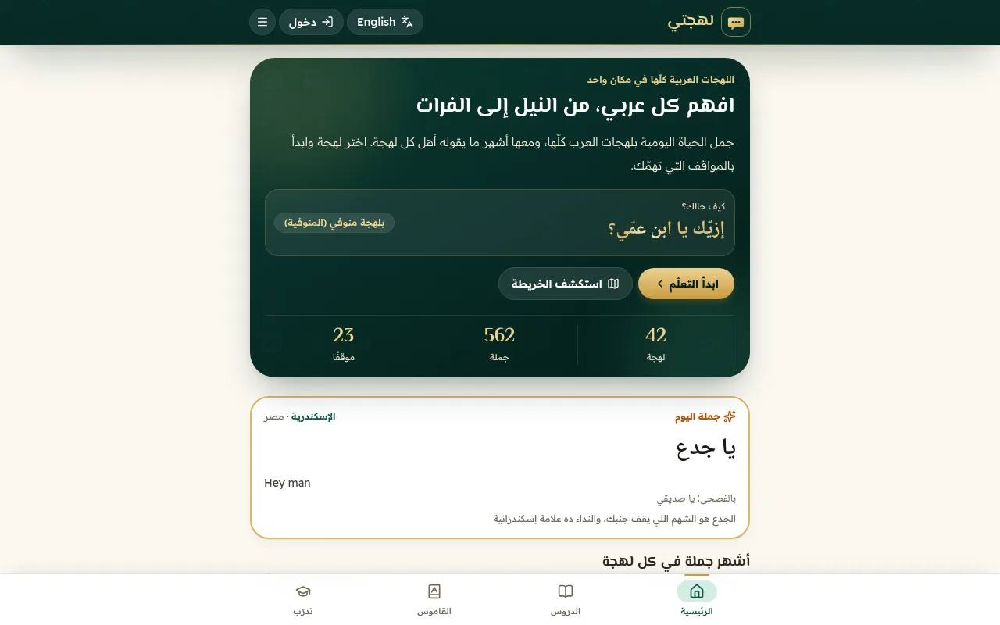

<div align="center">

# Lahjaty · لهجتي

### Learn the Arabic dialects, side by side

For Arabs who want to understand other dialects, and for learners of Arabic.
Modern Standard Arabic and dialects from every region, everyday phrases grouped by
situation, and the famous phrases of each dialect.

[](https://lahjaty.pages.dev)
[](https://nextjs.org)
[](https://tailwindcss.com)
[](https://pages.cloudflare.com)

[](https://lahjaty.pages.dev)

**[Pick a dialect →](https://lahjaty.pages.dev)**

</div>

---

## Features

- **Dialect picker** grouped by region, with search.
- **Lessons by situation** — phrase cards with English meaning, Standard Arabic
  equivalent, transliteration (where available) and audio (where available).
- **Compare view** — one sentence in Standard Arabic and every dialect side by side.
- **Practice** — pick the meaning, and guess the dialect of a sentence.
- **Favorites and progress** saved in the browser; no accounts, no backend.
- **Arabic UI (RTL)** with an English UI toggle (LTR), mobile first.
- **Fully prerendered** — every page (home, dialects, lessons, dictionary topics, one
  page per word and per shared phrase) ships as static HTML with its own title,
  description, Open Graph/Twitter tags and JSON-LD.
- **Works offline** — a service worker caches pages, assets, audio and share cards.

The content keeps growing, so nothing in the app or the docs states a fixed number of
dialects or phrases.

## Stack

Next.js (static export) · React · TypeScript · Tailwind CSS · Zustand · Cloudflare Pages.

## Run

```bash
npm install
npm run dev       # http://localhost:3000
npm test
npm run build     # static site in out/ (next build, then the og cards)
npm run preview   # serve out/ on http://localhost:4173
```

## Deploy

Deploys on Cloudflare Pages: build command `npm run build`, output directory `out`, Node 22.

- `NEXT_PUBLIC_SITE_URL` (or `SITE_URL` for the scripts) sets the absolute site URL used
  for canonical links, `og:url`, `og:image` and the sitemap. Default: `https://lahjaty.pages.dev`.
- Share cards are drawn at build time with resvg and sharp into `out/og`. If those native
  packages cannot load, or `OG_SKIP=1` is set, every card slot gets a copy of the prebuilt
  `public/og-default.jpg` and the build still succeeds.
- `public/_headers` carries the cache and security headers; `public/sw.js` is the offline
  service worker.

## Content and audio

See **[docs/CONTENT.md](docs/CONTENT.md)** for how to add audio, voices, phrases and
dialects (English, with an Arabic summary).

Quick version: drop MP3s in `public/audio/<dialectId>/<phraseId>.mp3` and run
`npm run audio:missing` to see what is left.

## Layout

```
src/content/phrases.json    all dialects, regions, situations and phrases
src/content/voices.json     optional voice manifest
public/audio/               audio files
scripts/                    audio index, missing-audio report, content check, og cards
src/app/                    routes (one prerendered page each), metadata, sitemap
src/lib/                    data access, quiz logic, store, i18n, the seo catalog
src/screens/, src/components/  UI (client components rendered by the app routes)
```

---

<div align="center">

Made with care by **Mohamed Alhinawi** · [lahjaty.pages.dev](https://lahjaty.pages.dev)

</div>
