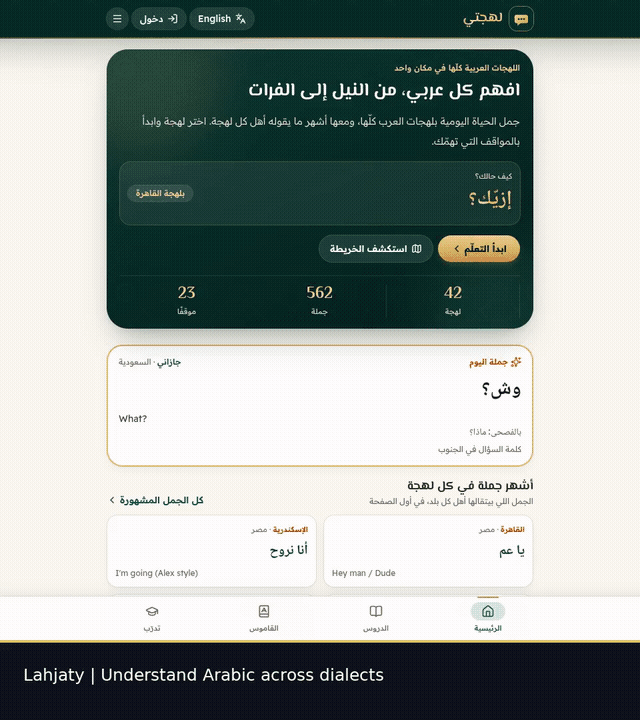

# Lahjaty | لهجتي

[Open the live site](https://lahjaty.pages.dev/)

Explore everyday Arabic across regions and dialects, with Standard Arabic and English meanings beside the phrases. Arabic RTL and English LTR interfaces are included.

## Live walkthrough



[Watch or download the MP4 recording](docs/demo/walkthrough.mp4). Two-voice Egyptian-Arabic narrated walkthrough, recorded from the live site on November 15, 2026; the interface may change as development continues.

## Features

- Searchable dialect picker, regional browsing and lessons by everyday situation.
- Phrase cards with meanings, transliteration and audio where available.
- Side-by-side dialect comparison, dictionary views and practice activities.
- Favorites and learning progress, with browser storage for guest use.
- Account/profile screens and a separate Hono + D1 backend in `backend/` for account features. This is no longer a frontend-only repository.
- Prerendered routes, share cards and an offline service worker.

## Stack

Next.js App Router with static export, React, TypeScript, Tailwind CSS and Zustand. Cloudflare Pages hosts the frontend; the separate account API uses Hono, Workers and D1.

## Run locally

```bash
npm install
npm run dev          # http://localhost:3000
npm run typecheck
npm test
npm run build        # static output in out/, copied to dist/
npm run preview      # http://localhost:4173
```

Use a current Node.js LTS release compatible with the installed Next.js version. `predev`, `pretest` and `prebuild` generate the audio index automatically.

## Content and audio

See [the content guide](docs/CONTENT.md). Audio is optional per phrase; missing audio is not fabricated.

```bash
npm run content:check
npm run audio:missing
```

- `src/content/phrases.json`: dialects, situations and phrases.
- `src/content/voices.json`: optional voice metadata.
- `public/audio/`: phrase recordings.
- `src/screens/`, `src/components/`: learning UI.
- `src/lib/`: data, translations, state and SEO helpers.

## Deployment and accounts

Build command: `npm run build`. Static output: `out/` (also copied to `dist/`). `NEXT_PUBLIC_SITE_URL` controls canonical links; `SITE_URL` is used by build scripts. Share cards are generated during the build, with a prebuilt fallback if optional native rendering dependencies are unavailable.

The API has separate dependencies and configuration:

```bash
cd backend
npm install
npm run db:migrate:local
npm run dev
npm run typecheck
```

Local D1 migrations do not change the remote database. Configure Google OAuth and other private secrets on the Worker, not in public frontend environment variables. Account availability depends on that deployment.
